# 02 — Katalog Tabel `staging` (27 tabel yang bisa dibaca)

> Setiap tabel dijelaskan dengan enam hal: **grain** (1 baris = apa), **jumlah baris**, **ukuran**, **asal** (dari flow mana), **isi**, dan **insight** (untuk apa dipakai).
>
> Verifikasi: 22 Sep 2026 · `pemeriksaan_reader` · PostgreSQL 16.15

---

## 1. Ringkasan 27 tabel

| Tabel | Grain (1 baris = …) | Baris | Ukuran | Asal |
|---|---|---:|---:|---|
| `bridge_pemeriksaan_checklist` | 1 item checklist | 7.388.165 | 775 MB | FLOW 3B |
| `bridge_pemeriksaan_skor_operasional` | 1 item berskor | 1.521.315 | 123 MB | FLOW 3 |
| `fact_pemeriksaan_approval` | 1 event approval | 1.320.680 | 259 MB | FLOW 6–7 |
| `bridge_pemeriksaan_petugas` | 1 petugas per kasus | 553.380 | 42 MB | FLOW 1 |
| `fact_pemeriksaan_narasi` | 1 potongan narasi | 525.894 | 256 MB | FLOW 4 |
| `dim_sarana` | 1 sarana | 441.821 | 105 MB | master |
| `bridge_pemeriksaan_temuan` | 1 temuan produk | 303.521 | 64 MB | FLOW 4 |
| `fact_pemeriksaan` | **1 kasus pemeriksaan** | 259.348 | 143 MB | FLOW 1–5 |
| `dim_produk` | 1 produk | 176.879 | 38 MB | master bersama |
| `bridge_pemeriksaan_vaksin` | 1 section form vaksin | 145.540 | 25 MB | FLOW 3B |
| `bridge_pemeriksaan_personel_faskes` | 1 peran personel | 131.898 | 9 MB | FLOW 3B |
| `fact_pemeriksaan_profil_faskes` | 1 kasus (satelit 1:1) | 72.890 | 15 MB | FLOW 3 |
| `bridge_pemeriksaan_komoditi_pbf` | 1 kode komoditi | 34.833 | 2 MB | FLOW 3B |
| `bridge_pemeriksaan_temuan_observasi` | 1 kode observasi GMP | 27.418 | 26 MB | FLOW 3B |
| `fact_pemeriksaan_profil_pangan_md` | 1 kasus (satelit 1:1) | 26.281 | 10 MB | FLOW 3B |
| `bridge_pemeriksaan_sertifikat_pangan_md` | 1 sertifikat | 23.404 | 3 MB | FLOW 3B |
| `bridge_pemeriksaan_fokus_pbf` | 1 kode fokus | 20.117 | 1 MB | FLOW 3B |
| `dim_user` | 1 user aplikasi | 13.322 | 2 MB | master |
| `dim_date` | 1 hari | 7.670 | 928 kB | master |
| `bridge_pemeriksaan_narasi_faskes` | 1 section narasi | 6.930 | 3 MB | FLOW 3B |
| `dim_master_data` | 1 kode kamus | 1.999 | 376 kB | master bersama |
| `dim_kabupaten` | 1 kabupaten | 664 | 128 kB | master |
| `dim_balai` | 1 balai/unit | 108 | 72 kB | master |
| `dim_pemeriksaan_aspek` | 1 `area_key` form | 47 | 32 kB | turunan FLOW 3 |
| `dim_provinsi` | 1 provinsi | 44 | 32 kB | master |
| `dim_status_code` | 1 kode status | 35 | 48 kB | turunan FLOW 6–7 |
| `dim_pemeriksaan_kesimpulan` | 1 kode kesimpulan | 14 | 48 kB | turunan FLOW 4 |

`public` juga memuat 26 tabel domain pengawasan yang **tidak** bisa dibaca (namanya terlihat di katalog, `SELECT` ditolak). Jangan dianggap bagian pemeriksaan.

**Total 2.497 MB**; `bridge_pemeriksaan_checklist` sendirian memakan 775 MB (31%) — selalu filter dulu sebelum menyentuhnya (Aturan #5).

---

## 2. Bentuk rancangan Fact–Dim–Bridge

```mermaid
erDiagram
    FACT_PEMERIKSAAN ||--o{ FACT_PEMERIKSAAN_APPROVAL : "id = pemeriksaan_id"
    FACT_PEMERIKSAAN ||--o{ FACT_PEMERIKSAAN_NARASI : "id = pemeriksaan_id"
    FACT_PEMERIKSAAN ||--o{ BRIDGE_PEMERIKSAAN_PETUGAS : "id = pemeriksaan_id"
    FACT_PEMERIKSAAN ||--o{ BRIDGE_PEMERIKSAAN_TEMUAN : "id = pemeriksaan_id"
    FACT_PEMERIKSAAN ||--o{ BRIDGE_PEMERIKSAAN_CHECKLIST : "id = pemeriksaan_id (Aturan #6)"
    FACT_PEMERIKSAAN ||--o{ BRIDGE_PEMERIKSAAN_TEMUAN_OBSERVASI : "id = pemeriksaan_id (Aturan #6)"
    FACT_PEMERIKSAAN ||--o{ BRIDGE_PEMERIKSAAN_SKOR_OPERASIONAL : "id = pemeriksaan_id (Aturan #6)"
    FACT_PEMERIKSAAN ||--o{ BRIDGE_PEMERIKSAAN_KOMODITI_PBF : "id = pemeriksaan_id"
    FACT_PEMERIKSAAN ||--o{ BRIDGE_PEMERIKSAAN_FOKUS_PBF : "id = pemeriksaan_id"
    FACT_PEMERIKSAAN ||--o{ BRIDGE_PEMERIKSAAN_VAKSIN : "id = pemeriksaan_id (Aturan #6)"
    FACT_PEMERIKSAAN ||--o{ BRIDGE_PEMERIKSAAN_NARASI_FASKES : "id = pemeriksaan_id (Aturan #6)"
    FACT_PEMERIKSAAN ||--o| FACT_PEMERIKSAAN_PROFIL_PANGAN_MD : "satelit 1:1, jenis_id=5"
    FACT_PEMERIKSAAN ||--o{ BRIDGE_PEMERIKSAAN_SERTIFIKAT_PANGAN_MD : "id = pemeriksaan_id"
    FACT_PEMERIKSAAN ||--o| FACT_PEMERIKSAAN_PROFIL_FASKES : "satelit 1:1, klaster faskes"
    FACT_PEMERIKSAAN ||--o{ BRIDGE_PEMERIKSAAN_PERSONEL_FASKES : "id = pemeriksaan_id"
    FACT_PEMERIKSAAN }o--|| DIM_SARANA : "sarana_id"
    FACT_PEMERIKSAAN }o--|| DIM_PEMERIKSAAN_KESIMPULAN : "kesimpulan_balai_id / kesimpulan_pusat_id / vaksin_kesimpulan_id (Aturan #20)"
    FACT_PEMERIKSAAN }o--|| DIM_STATUS_CODE : "status_id (domain=pemeriksaan)"
    FACT_PEMERIKSAAN }o--|| DIM_BALAI : "balai_id"
    FACT_PEMERIKSAAN }o--|| DIM_MASTER_DATA : "jenis_id / tujuan_id / klasifikasi_id"
    BRIDGE_PEMERIKSAAN_SKOR_OPERASIONAL }o--|| DIM_PEMERIKSAAN_ASPEK : "area_key"
    BRIDGE_PEMERIKSAAN_PETUGAS }o--|| DIM_USER : "user_id"
    BRIDGE_PEMERIKSAAN_TEMUAN }o--|| DIM_PRODUK : "tp_product_id"
    DIM_SARANA }o--|| DIM_PROVINSI : "provinsi_id"
    DIM_SARANA }o--|| DIM_KABUPATEN : "kabupaten_id"
```

Kenapa ada tabel bridge: satu pemeriksaan bisa punya 9 temuan produk, 166 item checklist, dan 5 event approval. Bentuk seperti itu tidak mungkin dimuat dalam satu baris fact. Bridge = jembatan antara data pemeriksaan dan data dimensi.

---

## 3. Fact (5 tabel)

### 3.1 `fact_pemeriksaan` — 44 kolom, 259.348 baris, 143 MB

Grain 1 baris = 1 kasus. Punya **6 index** (PK `id`, `balai_id`, `jenis_id`, `sarana_id`, `status_id`, `tgl_start`) dan `id` unik sempurna (259.348 = 259.348).

| Kelompok kolom | Kolom | Insight |
|---|---|---|
| Header | `id`, `sarana_id`, `balai_id`, `jenis_id`, `tujuan_id`, `klasifikasi_id`, `metode_inspeksi`, `status_id`, `kasus_id`, `penelusuran_id`, `unit_id`, `form_version_id`, `flag_varian_datas` | dimensi kasus + routing bridge |
| Waktu | `tgl_start`, `tgl_end`, `created_at`, `updated_at` | tren, periode, kesegaran data |
| Surat | `no_surat`, `tgl_surat` | penelusuran dokumen (Aturan #18) |
| Array/jsonb | `sediaan_kode`, `jenis_pangan_kode`, `tl_saran`, `tl_saran_pusat` | sediaan & saran TL (Aturan #17; `tl_saran` merujuk 7 kamus) |
| Hasil | `kesimpulan_balai_id`, `kesimpulan_pusat_id`, `grade`, `tl_capa`, `kritis_count`, `major_count`, `minor_count`, `level_kesimpulan`, `tl_attachment`, `tl_ba`, `tl_attachment_pusat`, `tl_ba_pusat` | vonis sarana, kualitas, kekritisan, tindak lanjut |
| Khusus vaksin | `vaksin_kesimpulan_id`, `vaksin_bersama_rutin`, `vaksin_status_capa` | penilaian independen dari kesimpulan umum (Aturan #20) |
| Lain-lain | `klasifikasi_sarana_kode`, `status_ss`, `profil_sarana_json`, `is_data_uji`, `created_by`, `updated_by` | status sarana saat diperiksa, data uji, cadangan jsonb (Aturan #11) |

### 3.2 `fact_pemeriksaan_approval` — 12 kolom, 1.320.680 baris, 259 MB

Grain 1 baris = 1 event workflow. `act_steps` / `to_steps` / `status` / `notes` / `notes_tl` / `created_at` / `created_by`.
**Insight**: funnel & bottleneck verifikasi, durasi antar tahap, label role verifikator (dari `notes`).

### 3.3 `fact_pemeriksaan_narasi` — 3 kolom, 525.894 baris, 256 MB

Grain 1 baris = 1 potongan narasi per (`pemeriksaan_id`, `jenis_narasi`). 9 `jenis_narasi`: `catatan_balai` (189.159) · `tindak_lanjut_detil` · `hasil_balai` · `tindak_lanjut_detil_pusat` · `hasil_pusat` · `catatan_pusat` · `rekomendasi` · `analisa` · `detail_tmk`.
**Insight**: analisis teks (alasan TMK, pola temuan naratif). HTML sudah distrip (Aturan #9).

### 3.4 `fact_pemeriksaan_profil_faskes` — 25 kolom, 72.890 baris (satelit 1:1)

PK `pemeriksaan_id`. Cakupan `jenis_id` 109/107/108/106/105/748.
**Isi**: `jenis_sarana_json` + field umum (`is_kasus`, `jenis_obat`, `manfaat_it`, `ttk_places`, `resep`) + field khusus per jenis (`akreditasi`/`ap_oprs` Apotek; `penanggungjawab`/`pengadaan` PKM; `layanan`/`pelayanan`/`ruang_farmasi` Klinik; `fs`/`kelas` IFRS; `prekursor`/`to_oprs` Toko Obat).
**Insight**: kapasitas & kelengkapan sarana pelayanan. ⚠️ `resep` tidak seragam tipe (kadang angka, kadang JSON-string).

### 3.5 `fact_pemeriksaan_profil_pangan_md` — 24 kolom, 26.281 baris (satelit 1:1)

PK `pemeriksaan_id`, cakupan `jenis_id`=5.
**Isi**: `pimpinan`, `alamat_*`, `email_*`, `telp_*`, `nib`, `nie`, `skala_usaha`, `tahun_berdiri`, `tgl_operasi`, `jumlah_karyawan`, `kapasitas`, `distribusi_provinsi_kode`, `manajemen_mutu`, `proses_pengolahan`, `subkontrak*`.
**Insight**: profil industri pangan MD — skala usaha, kapasitas, tujuan distribusi.

---

## 4. Bridge (11 tabel)

| Tabel | Kolom kunci | Cakupan flag | Insight |
|---|---|---|---|
| `bridge_pemeriksaan_checklist` (7, 7.388.165) | `pemeriksaan_id`, `jenis_id`, `sumber_pola`, `path`, `nilai_aspek`, `catatan`, `conformity` | `pola1_direct` / `pola1_nested` / `pola1_observation` | cacah klausul tidak sesuai; severity untuk sebagian jenis |
| `bridge_pemeriksaan_skor_operasional` (6, 1.521.315) | `pemeriksaan_id`, `area_key`, `score`, `fp`, `n`, `opsi` | `clusterC_skor` | kepatuhan per aspek (satu-satunya bridge dengan kamus aspek) |
| `bridge_pemeriksaan_temuan` (19, 303.521) | `tp_product_id`, `kategori_kode`, `tindakan_kode`, `klasifikasi_produk_kode`, `unit_kode`, `bets`, `tgl_expire`, `jumlah_temuan`, `harga`, `harga_total`, `is_kasus_draft`, `tp_asset` | semua (hasil FLOW 4) | temuan produk terbanyak, nilai sitaan, tindakan |
| `bridge_pemeriksaan_petugas` (3, 553.380) | `user_id`, `urutan` | semua | beban inspektur, komposisi tim |
| `bridge_pemeriksaan_temuan_observasi` (5, 27.418) | `urutan`, `observasi_kode`, `kriteria`, `catatan` | `pola2_klasifikasi` | temuan GMP per kode baku |
| `bridge_pemeriksaan_komoditi_pbf` (2, 34.833) | `komoditi_kode` | `pola1_*` (14/747/12) | cakupan komoditi PBF/IFK/IFP (Aturan #16) |
| `bridge_pemeriksaan_fokus_pbf` (2, 20.117) | `fokus_kode` | sama | fokus pemeriksaan |
| `bridge_pemeriksaan_sertifikat_pangan_md` (8, 23.404) | `urutan`, `jenis`, `nomor`, `lembaga`, `expired` | `jenis_id`=5 | sertifikasi yang dimiliki sarana (SNI/HACCP/Halal/ISO) |
| `bridge_pemeriksaan_personel_faskes` (3, 131.898) | `urutan`, `peran` | klaster faskes | komposisi tenaga (Apoteker/TTK/Asisten/Perawat) |
| `bridge_pemeriksaan_vaksin` (7, 145.540) | `section_key` (19 varian), `opsi`, `jumlah`, `observasi`, `perbaikan`, `intervensi` | `clusterC_vaksin` | kepatuhan program vaksin — **baru 21 Sep 2026** |
| `bridge_pemeriksaan_narasi_faskes` (3, 6.930) | `section` (8 nilai), `teks` | `clusterC_naratif` | narasi inspektur per bagian — **baru 21 Sep 2026** |

**Catatan penting soal index**: 11 tabel bridge **tidak punya primary key** — semuanya hanya punya index pada `pemeriksaan_id` (dan `bridge_pemeriksaan_temuan` tambahan index `tp_product_id` + PK `id`). Artinya query yang memfilter selain `pemeriksaan_id` akan full scan. Itu wajar untuk tabel bridge, tapi harus disadari saat menyusun agregasi berat.

---

## 5. Dim khusus pemeriksaan (3 tabel)

| Tabel | Baris | Isi | Insight |
|---|---:|---|---|
| `dim_sarana` (24 kolom, 4 index) | 441.821 | nama, alamat, NIB/NPWP, `type_id`, `status_sarana`, provinsi/kabupaten, lat/long, `aktif`, `dihapus_di_sumber`, banyak ID silang sistem lain (`legal_id`, `idcdob`, `kode_satu_sehat`, `plant`) | siapa yang diperiksa, di mana; exact match dengan sumber (Aturan #19) |
| `dim_pemeriksaan_aspek` (5 kolom) | 47 | `area_key` (PK), `aspek_ktl_kode`, `aspek_ktl_nama`, `aspek_label`, `status_kamus` | satu-satunya kamus aspek; 40 resmi + 7 belum ada di kamus (Aturan #7) |
| `dim_pemeriksaan_kesimpulan` (5 kolom) | 14 | `id`, `kode`, `keterangan`, `status`, `sumber` dalam 3 kelompok (umum 1–5, CPOB 791–794, vaksin 795–799) | vonis sarana & tingkat pemenuhan (Aturan #1, #20) |

---

## 6. Dim general (8 tabel, dipakai bersama domain pengawasan)

| Tabel | Baris | Isi | Insight |
|---|---:|---|---|
| `dim_master_data` | 1.999 | 10 kolom; **72 tipe kamus** dibedakan kolom `type` | semua arti kode dropdown — lihat [06-kamus-dan-dimensi.md](06-kamus-dan-dimensi.md) |
| `dim_produk` | 176.879 | NIE, nama, merk, pendaftar, produsen, kategori, kemasan, golongan, `tgl_terbit`/`tgl_kadaluarsa`, `is_imported` | produk yang jadi temuan; dim bersama lintas domain (Aturan #10) |
| `dim_user` | 13.322 | `fullname`, `username`, `email`, `balai_id`, `roles_id`, `group_id`, `active`, `kode_sarana` | nama inspektur & verifikator; `balai_id = 0` = user pusat (bukan join rusak) |
| `dim_balai` | 108 | `nama_balai`, `jenis_balai`, `regional`, `regional_name`, `provinsi_id`, `kabupaten_id`, `target_sampling`, `target_sarana` | breakdown regional & target |
| `dim_date` | 7.670 | `date_key` (PK), tahun, bulan, kuartal, minggu, nama hari, `is_weekend`, awal/akhir bulan | melengkapi periode; mulai 2015 |
| `dim_provinsi` | 44 | kode & nama provinsi | wilayah sarana |
| `dim_kabupaten` | 664 | kode & nama kabupaten | wilayah sarana |
| `dim_status_code` | 35 | `domain` (pemeriksaan 16 + pengawasan 19), `status_code`, `status_label` ⚠️ **kosong semua** | status workflow kasus — label harus dari luar tabel |

---

## 7. Kolom yang praktis mati (jangan diandalkan)

| Kolom | Terisi | Kenapa |
|---|---:|---|
| `fact_pemeriksaan.tl_ba_pusat` | 0,0% | tidak dipakai |
| `fact_pemeriksaan.tl_attachment_pusat` | 0,1% | idem |
| `fact_pemeriksaan.sediaan_kode` | 0,3% | hampir selalu kosong |
| `fact_pemeriksaan.unit_id` | 0,6% | jarang |
| `fact_pemeriksaan.penelusuran_id` / `kasus_id` | 0,7% / 0,8% | jarang |
| `fact_pemeriksaan.metode_inspeksi` | 1,6% | jarang |
| `dim_status_code.status_label` | 0% | label tidak diisi |
| `dim_produk.is_imported` | 100% `false` | tidak informatif |
